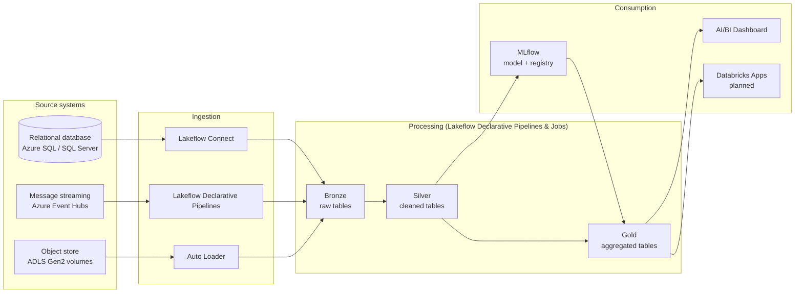

# Smart Claims Lakehouse

An insurance-claims analytics project on **Azure Databricks with ADLS Gen2 storage**, built as a medallion architecture (Bronze → Silver → Gold) and packaged as a Databricks Asset Bundle / Git folder.

Data comes from three kinds of source system (Azure SQL / SQL Server, Azure Event Hubs and ADLS Gen2), is ingested into Bronze tables, cleaned into Silver, aggregated into Gold, and consumed through an AI/BI dashboard. An image-classification model and a rule engine score claims for investigation.


## Architecture



```text
SOURCE                  INGESTION                    PROCESSING                  CONSUMPTION
Relational database --> Lakeflow Connect ----+
Message streaming   --> Declarative Pipelines +--> Bronze --> Silver --> Gold --> AI/BI Dashboard
Object store        --> Auto Loader ---------+                  |         ^      Databricks Apps (planned)
                                                                +-> MLflow model + rule engine
```

DBSQL, Lakebase, Mosaic AI Serving and AI/BI Genie appear in the target architecture but no code was provided for them, so they have no folders yet.

## Notebooks and layers

| File | Layer | Purpose |
|---|---|---|
| `src/ingestion/lakeflow_connect/db_setup.sql` | Ingestion (source DB) | T-SQL to create the `claims_dev` source database and enable change tracking / CDC (`sys.sp_cdc_enable_db`). Runs on Azure SQL / SQL Server, not Databricks. |
| `src/ingestion/streaming/eventhubs_parsed.py` | Ingestion → Bronze | Declarative table `telematics`, parsed from Event Hubs (Kafka endpoint) |
| `src/ingestion/autoloader/autoloader_cleansource.py` | Ingestion → Bronze | Auto Loader of claim images into `01_bronze.claim_images` (job notebook task) |
| `src/ingestion/autoloader/ingest_training_imgs.py` | Ingestion → Bronze | Declarative table `01_bronze.training_images` |
| `src/ingestion/autoloader/metadata_imgs_schema.py` | Ingestion → Bronze | Declarative table `claim_images_meta` |
| `src/processing/silver/01_bronze_to_silver.py` | Silver | Cleans telematics, policy, claim, customer, training and claim images |
| `src/processing/gold/02_silver_to_gold.py` | Gold | Aggregated telematics, customer/claim/policy join, geolocated claims |
| `src/ml/ML_Notebook.ipynb` | ML | Fine-tunes ResNet-50 on damage images, registers the model in Unity Catalog, scores images |
| `src/ml/Rule_Engine.ipynb` | ML / Gold | Rule-based checks that produce `03_gold.claim_insights` |
| `src/consumption/dashboards/smart_claims_investigation.lvdash.json` | Consumption | AI/BI dashboard "FSI - Smart Claims Investigation" |
| `src/consumption/apps/README.md` | Consumption | Placeholder for the Databricks App ("To be uploaded") |

Bronze tables are created by the ingestion code, so `src/processing/bronze/` does not exist.

## Bundle resources

| Resource | File | What it runs |
|---|---|---|
| Pipeline `sqlserver_gateway` + `sqlserver_ingestion` | `resources/pipelines.yml` | Lakeflow Connect for `policy`, `claim`, `customer` |
| Pipeline `streaming_ingestion` | `resources/pipelines.yml` | `eventhubs_parsed.py` |
| Pipeline `autoloader_ingestion` | `resources/pipelines.yml` | `ingest_training_imgs.py`, `metadata_imgs_schema.py` |
| Pipeline `silver_pipeline` | `resources/pipelines.yml` | `01_bronze_to_silver.py` |
| Pipeline `gold_pipeline` | `resources/pipelines.yml` | `02_silver_to_gold.py` (installs `geopy`) |
| Job `medallion_job` | `resources/jobs.yml` | 4 ingestion tasks in parallel → silver → gold |
| Job `ml_scoring_job` | `resources/jobs.yml` | `ML_Notebook` → `Rule_Engine` (run after `medallion_job`) |
| Dashboard | `resources/jobs.yml` | AI/BI dashboard |

## How to run

1. Fill in the placeholders: `<workspace-host>`, `<sqlserver-connection-name>`, `<gateway-storage-schema>`, `<sql-warehouse-id>`, `<notification-email>`, `<entra-service-principal-application-id>` in `databricks.yml`, and `<eventhubs-namespace>`, `<telematics-event-hub-name>`, `<secret-scope>`, `<eventhubs-connection-string-key>` in `eventhubs_parsed.py`.
2. Set up Azure storage and Unity Catalog following [docs/azure_setup.md](docs/azure_setup.md): ADLS Gen2 account, access connector, storage credential, external locations, the catalog `smart_claims_dev` with schemas `00_landing`, `01_bronze`, `02_silver`, `03_gold`, and the external volumes `00_landing.claims` and `00_landing.training_imgs`.
3. Prepare the source database with `db_setup.sql`, create the Unity Catalog connection, and create the Event Hubs namespace and secret scope (also covered in the setup guide).
4. Install the [Databricks CLI](https://docs.databricks.com/dev-tools/cli/install.html) and authenticate: `databricks auth login --host <workspace-host>`.
5. Validate, deploy and run:

```bash
databricks bundle validate -t dev
databricks bundle deploy   -t dev
databricks bundle run medallion_job   -t dev
databricks bundle run ml_scoring_job  -t dev
```

The SQL Server gateway pipeline runs continuously and must be started once before the first `medallion_job` run.

## Link the repo in Databricks (Git folder)

1. Push this project to GitHub.
2. In the workspace go to **Workspace → Create → Git folder**.
3. Paste the GitHub repository URL, choose the provider, and click **Create Git folder**.
4. Link a GitHub credential under **Settings → Linked accounts** if prompted.
